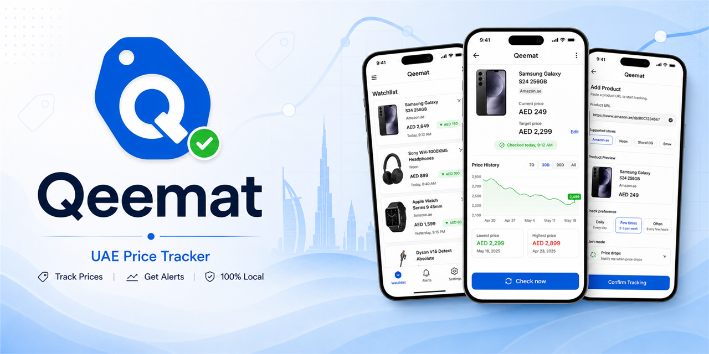

# Qeemat



Qeemat is an Android-first, local-first shopping app for UAE retailers. It tracks prices on supported product pages, helps you discover products across stores, and compares the same item when different retailers offer it. Data stays on the device; there is no account, backend or cloud sync.

[**Download the latest release APK**](https://github.com/AdamJeddy/Qeemat/releases/latest) · [Release notes](https://github.com/AdamJeddy/Qeemat/releases)

## What Qeemat does

- **Watchlist:** track products with local price history, current/last-known price, direction, availability, retailer, selected variant, folders and last-check state. Recheck one item, all items, or let the best-effort Android background checks run.
- **Explore:** a cross-store discovery feed ranked by a local taste profile built from your active watchlist. Browse departments, stores and store categories, search product names, filter by department/store/brand/maximum price, and inspect source coverage.
- **One product, many stores:** compatible listings from different retailers are clubbed into one grouped row. The row shows the lowest comparable source and saving, and the compare sheet lists each retailer's own title, price, availability, previous observation and check age, lowest price first.
- **Add and track:** paste a product URL or share one from an Android browser. Qeemat verifies the page, lets you choose an exact source-defined variant when available, then saves the tracker.
- **Activity:** a local history grouped by calendar day, with the new price first, the previous price struck through, and explicit direction badges (green drop, red rise). It is a price/availability history, not a notification inbox.
- **Alerts:** per-tracker price-drop, any-change or target-price alerts, minimum drop thresholds, and back-in-stock alerts. Android 13+ requires notification permission.
- **Product detail:** compact summary, local price insights (low/high/average), a labelled interactive price chart, snapshot provenance, copy and native share.
- **In-app updates:** when a newer GitHub release is available, Qeemat can download the compatible APK inside the app, verify size/SHA-256 when published, and open Android's install prompt. The background update check posts one **App updates** notification per release.

## Supported stores

20 storefronts support tracking; discovery/search coverage varies by source.

- Noon UAE
- Carrefour UAE
- Nike UAE
- Sun & Sand Sports UAE
- Level Shoes
- AYM Accessories
- Ounass UAE
- Amazon (selected regional domains)
- Adidas UAE
- PUMA UAE
- Decathlon UAE
- Salomon GCC
- Sephora UAE
- Faces UAE
- Centrepoint UAE
- Namshi UAE
- The Deal UAE
- Sharaf DG UAE
- H&M UAE
- Zara UAE

Brands For Less is an experimental integration and remains hidden from the supported-store UI because Cloudflare blocks reliable fetching. See [BFL integration](docs/bfl-integration.md).

## Install and update

1. Download the latest APK from [GitHub Releases](https://github.com/AdamJeddy/Qeemat/releases/latest).
2. Android will ask you to allow installs from the app you use to open the APK. This is required for sideloaded builds.
3. The first launch offers notification permission and battery-optimisation guidance; both can be skipped.
4. Later releases can be installed from **Download and install** in the update popup, or from the same GitHub release page.

Qeemat's releases use the same signing certificate so an update can be applied over an existing install. Android still verifies the signature; a differently signed APK will be rejected. The app is Android-only and targets a modern Android phone (minSdk 24, targetSdk 36).

## Documentation

Current behavior and limits:

- [Current state and developer handoff](docs/current-state.md)
- [Product scope](docs/mvp-scope.md)
- [Design QA and device evidence](design-qa.md)
- [Design system](DESIGN.md) and [design-system review](docs/design-system-review.md)
- [In-app update flow](docs/in-app-update.md)
- [Explore review and behaviour](docs/search-tab-review.md)
- [Accessibility audit](docs/accessibility-audit.md)
- [Product metadata audit](docs/product-metadata-audit.md)
- [Adding a new source](docs/adding-a-source.md) and [source onboarding template](docs/source-onboarding-template.md)

Discovery and tracking references:

- [Discovery source register](docs/discovery-sources.md)
- [Discovery category audit](docs/discovery-category-audit.md)
- [Product-name search evidence](docs/discovery-search-feasibility.md)
- [Exact variant tracking](docs/variant-tracking.md)
- [Website mini icons](docs/site-icons.md)
- [Brands For Less integration](docs/bfl-integration.md)

Release notes and design history are under [`release/`](release/) and the [design handover](docs/design-handover.md). Some documents are dated snapshots; each historical review is marked where its decisions have since been superseded.

## Development

```bash
npm install
npm run start
npm run android:device
```

Checks:

```bash
npm run typecheck
npm run lint
npm test -- --runInBand
```

Build an Android release from `android/`:

```bash
.\gradlew.bat :app:assembleRelease
```

Terminal builds require JDK 17+ and `adb` from Android SDK platform-tools; Android Studio's bundled JBR works. The arm64 APK is `android/app/build/outputs/apk/release/app-arm64-v8a-release.apk`.

## Project constraints

- Android-first, local-first: no backend, account, cloud sync, SQLite or maintained iOS native target.
- React Native + TypeScript; screens use a manual route stack in `App.tsx`, not React Navigation.
- AsyncStorage is the only database. Tracking, discovery cache and price history remain local.
- Prices and availability are observations from retailer pages, not real-time guarantees. Retailers can change layouts, block requests or return partial results.
- Android background work is best effort; battery and vendor restrictions can delay checks and update notifications.
- Qeemat is in alpha. Discovery and search source coverage remains incomplete and is documented per feature.
