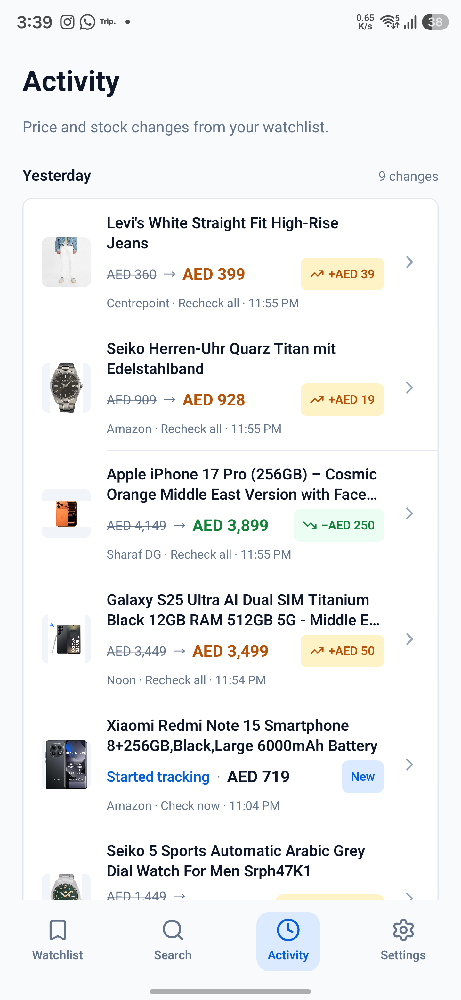
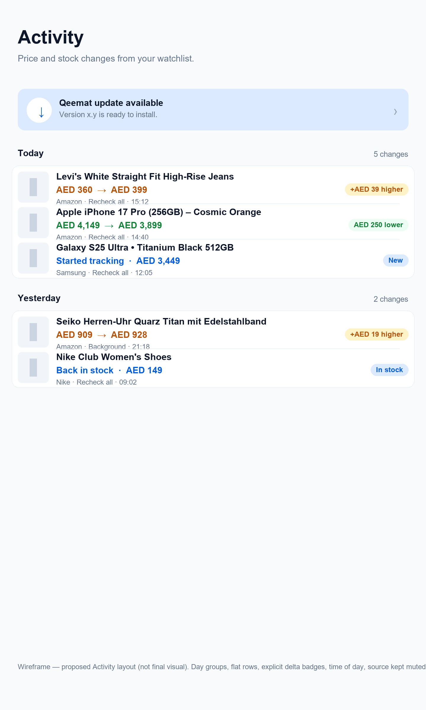

# Activity redesign — proposal and implementation

**Status:** implemented on 14 November 2026 (Direction A). The plan below is the approved design record; final refinements during implementation: flat rows inside one `Surface` per day, compact delta badges (`+AED 39` / `−AED 250`), stock rows use their state text without duplicate badges, the meta line wraps instead of truncating at large font scales, and `ActivityList` renders deleted products as a non-tappable row with a “Product removed” note. Device-verified on the Samsung SM-S928B (populated, 1.3 font scale and landscape).

## Why

The handover says Activity is a **history of price/availability events**, not a notification inbox, and the design review left its layout as an open pass. The current screen works but is hard to scan once there are more than a few events.

### Current structure

- Header: **Activity** + “Recent price changes across all tracked products.”
- Optional pinned update card.
- Events grouped by `formatRelativeTime(checkedAt)` labels (“15h ago”, “16h ago”, “Yesterday”), each event in its own bordered card.
- Each card: thumbnail, product title, price transition (old struck-through → colored new price + direction icon), source label (“Recheck all”), optional “Started tracking” badge.
- Tapping a row opens the product detail (unless the product was deleted).
- Empty state card, loading spinner.

### Problems

1. **Unstable group headers.** “15h ago” / “16h ago” are moving labels, so the same day splits into several groups, and the headers change meaning over time. A day header should be a stable date, not a relative timestamp.
2. **Heavy per-event cards.** One bordered card per event means ~4 events per screen; long histories need a lot of scrolling. Watchlist already uses flat rows with dividers — Activity is inconsistent with the rest of the app.
3. **Repetition.** Every row repeats “Recheck all” (source) and a full card frame; the actual change is one line of text.
4. **No explicit delta.** The new price is colored and has a direction icon, but the amount is only implied by comparing strikethrough numbers. Watchlist uses explicit “AED 49 lower” badges.
5. **No time-of-day.** Events within the same day are indistinguishable; “15h ago” is the only temporal cue.
6. **Copy is inaccurate.** It says “Recent price changes” but also includes restocks/out-of-stock events, and the first-observed “Started tracking” event is not a price change.
7. **Accessibility gaps.** Date headers are plain text (not headings), rows have no explicit labels, and a tapped row exposes no “opens product” hint.

## Proposed direction A — Calendar day groups with flat event rows (recommended)

### Layout

- Header stays “Activity”; subtitle changes to **“Price and stock changes from your watchlist.”**
- **Day groups with stable labels:** `Today`, `Yesterday`, then `Mon, 10 Nov` (add year only when needed). Right-aligned count: `5 changes`.
- **One flat `Surface` per day**, containing compact rows separated by hairlines (same pattern as Watchlist). No per-row borders; no empty card frames.
- **Event row (~88–96dp):**
  - 44×44 thumbnail (muted placeholder when missing).
  - Product title (semibold, 2 lines max).
  - **Price/status line:** old price muted strikethrough → new price in direction color; explicit right-aligned badge: `+AED 39 higher` (amber soft), `AED 250 lower` (green soft). For first observation: `Started tracking · AED 719` with a blue `New` badge. For stock events: `Back in stock · AED 149` / `Out of stock · last AED 149` with a blue/amber badge.
  - **Meta line:** retailer short name · source (muted, e.g. `Amazon · Recheck all · 15:12`). Source stays a provenance label, never a colored badge.
  - Row is tappable when the product still exists; keep press feedback and maybe a subtle chevron. Deleted products show the row non-tappable with a muted “Product removed” note instead of silently doing nothing.
- **Pinned update card** keeps its current behaviour and position, restyled with `Surface variant="accent"` so it matches the new Activity surfaces.
- Empty state stays a centered `Surface` card with corrected copy; loading state unchanged.

### Data/grouping rules

- New pure helper `groupActivityEventsByDay(events)`:
  - groups consecutive events by **local calendar day** of `checkedAt` (events are already newest-first from `listActivityEvents`);
  - returns `{ key, label, count, events }` with `Today` / `Yesterday` / `EEE, d MMM` labels;
  - unit-tested with fixed clocks (timezone-safe via local date formatting).
- Time-of-day helper for the meta line (`h:mm AM/PM`) in the device locale.
- Keep the existing 50-event limit; no new storage or pagination in this pass.
- "Started tracking" stays (it is useful context for a new product), but gets the `New` badge and is no longer mixed into “price change” copy.

### Tokens/components

- `Surface` (`card` per day, `accent` for update pin), `AppText` roles, `colors.green/amber/blueSoft`, `radius`, `spacing`, hairline dividers.
- Reuse the direction colors/badge treatment from `PriceDirectionBadge`; extract a shared delta-badge helper if the styling repeats in Watchlist and Activity.

### Accessibility

- Day labels: `accessibilityRole="header"` (e.g. “Today, 5 changes”).
- Each row: one focusable button with an explicit label, e.g. “Levi's … AED 360 to AED 399, AED 39 higher, Amazon, Recheck all, 15:12, open product”.
- The update pin keeps its existing `accessibilityRole`/label.
- Row heights ≥ 44dp, text scales with the same 1.3 cap.

## Alternatives (for comparison)

- **B — Keep cards, fix grouping only.** Lowest risk: stable day headers, explicit delta, time-of-day; keeps per-event borders and low density. Less consistent with Watchlist.
- **C — Timeline rail.** Vertical line + dots per event; distinctive but heavier visually, harder at small text sizes, more code for little scannability gain — not recommended.

## Implementation plan (after approval)

1. `src/domain/activity.ts` (or `dates.ts` addition): `groupActivityEventsByDay` + `formatActivityTime`, with Jest tests (fixed dates, today/yesterday/older, deleted-product note).
2. Rewrite the `ActivityScreen` list only; keep data loading, pinned update card, empty/loading states, and navigation behaviour.
3. Add compact row component + styles; reuse `Surface`, `SourceLabel`, direction colors; add accessibility labels/roles.
4. Tests: grouping helper; render-test the screen states (empty, first observation, drop, rise, stock change, deleted product) if the list is extracted into a testable component.
5. Device check on the Samsung: populated list, empty state (fresh data), 1.3/1.5 font scale, landscape, TalkBack labels/targets; screenshots into `docs/assets/activity-redesign/`.
6. Update `design-qa.md` / `docs/current-state.md`; one PR to `dev`.

Estimated: one focused branch/PR, frontend only, no schema/storage changes.

## Decisions needed before coding

1. Direction A (flat day groups) vs B (keep cards)?
2. Keep “Started tracking” events with a `New` badge? (recommended: yes)
3. Day labels: `Today` / `Yesterday` / `Mon, 10 Nov` — OK?
4. Show the per-day change count? (recommended: yes)
5. Any summary strip (“3 drops · 1 rise · 2 stock changes”)? (recommended: no for the first pass — keep it calm)
