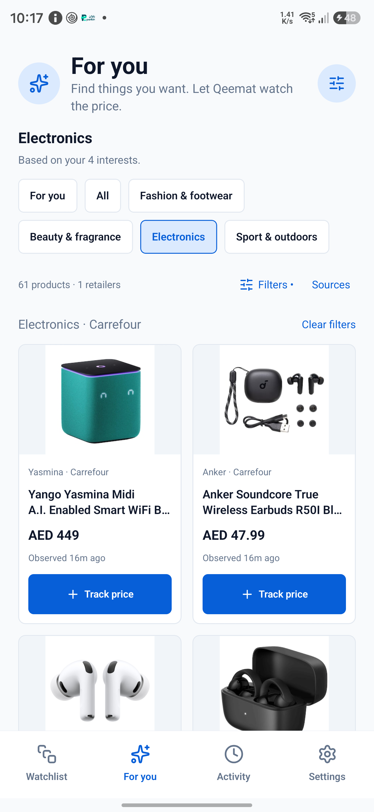
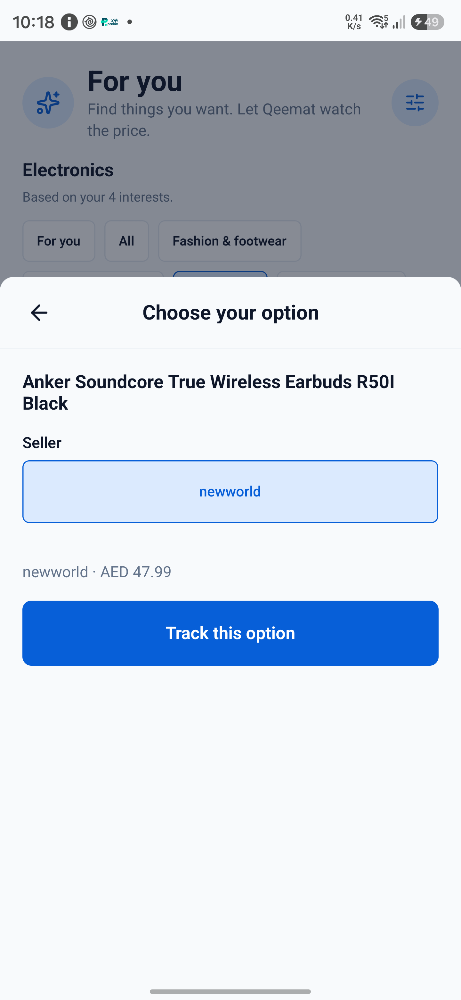
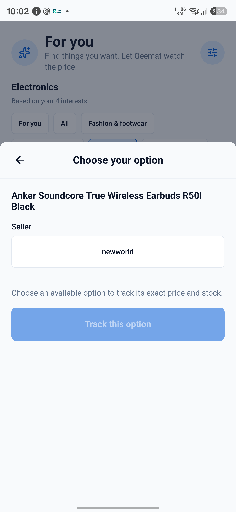
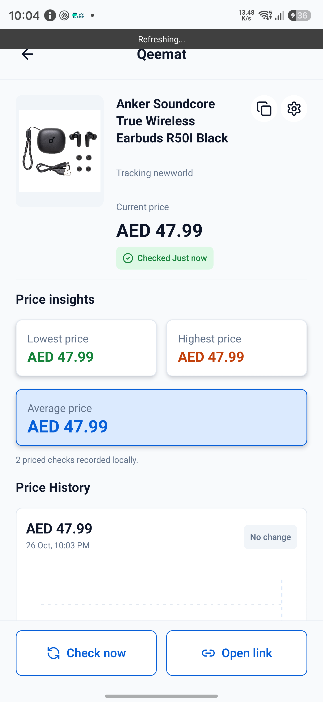

# Carrefour UAE integration

Added 26 October 2026. Carrefour is a retailer; Apple, Sony, Anker and other brands remain product brands.

## Scope and source

- Discovery: [Headphones & Earphones](https://www.carrefouruae.com/mafuae/en/c/NF1210300), mapped to Electronics. The source supplies its first page; no pagination or whole-store coverage is claimed.
- Tracking: UAE English product URLs ending in `/p/<product-id>`, with the source's `offer`, `sellerId` and `sid` retained.
- Product and listing extraction reads streamed JSON data without executing remote scripts. The product parser requires a matching product ID and complete offer identity; generic SEO metadata cannot override the requested seller.
- Each verified seller/offer/delivery combination is represented by an existing product option labelled with the seller. Subsequent checks verify that exact combination. Missing or changed offers fail safely, preserving the last successful observation.
- Prices reflect the storefront's current/default delivery context, including VAT where the storefront does. Qeemat does not select a delivery address, calculate checkout charges, apply coupon codes or compare every seller.
- Recognized unavailable stock states succeed without a price, using the existing last-known-price and restock behavior. Ambiguous stock remains unknown.
- Existing local tracking persistence, alerts, discovery cache, failure handling and foreground refresh scheduling are reused. No backend or private service API was added.

## Verification

Source-shaped tests cover seller/offer/delivery identity, changed offers, product ID matching, streamed chunks, unrelated recommendations, out-of-stock products, brand extraction, duplicate tiles and rejected external URLs. Live desktop responses supplied 61 distinct listings and a seller-specific AirPods product at AED 549 at the time of observation.

On the connected Galaxy S24 Ultra (SM-S928B), native Android HTTP supplied 61 listings. A Carrefour-sold AirPods product verified at AED 349. The visible discovery flow filtered to Carrefour, fetched a marketplace product, offered its actual seller `newworld`, and saved that seller's Anker R50I offer at AED 47.99. Tapping Tracking opened the existing tracker rather than adding a duplicate. The normal checker re-fetched the same product/seller/offer/delivery URL and recorded AED 47.99 successfully. The live marketplace stock value `normal` was added to recognized in-stock states and verified by another Android check.

The temporary QA tracker (ID 37) was deleted. The phone returned to 24 trackers, with original tracker IDs preserved. Category and retailer filtering did not change the user's saved preferences.

- Automated validation: 20 Jest suites passed, 209 tests passed and one existing skipped; strict typecheck passed; lint had no errors and one existing App.tsx inline-style warning.
- Raw storefront responses and diagnostic scripts remain under ignored `.tmp/carrefour/`.

## Standalone release check

The signed arm64 release APK built successfully and passed `apksigner verify`. It was installed with `adb install --no-streaming -r` on SM-S928B and launched with Metro stopped. Installed package `com.qeemat` reports version `0.5.5-alpha`, versionCode `3`, without `DEBUGGABLE`. The release displayed the 61-product Carrefour feed and performed a fresh product fetch that opened the same `newworld` seller selection. That second check did not save another QA tracker. No app-process AndroidRuntime or ReactNativeJS errors were reported.

APK SHA-256: `82c6d9c4813bcd0d5d1eb8acd188c6f2599f122228d9b6283ed4cb37993b1253`.

The repository's existing debug-keystore signing configuration is used for this standalone test build. Its JavaScript is bundled in the APK; the laptop is not required to run it.

