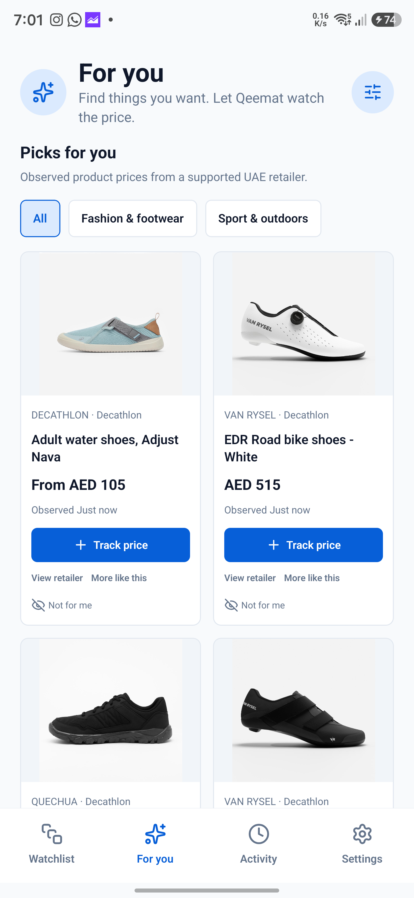
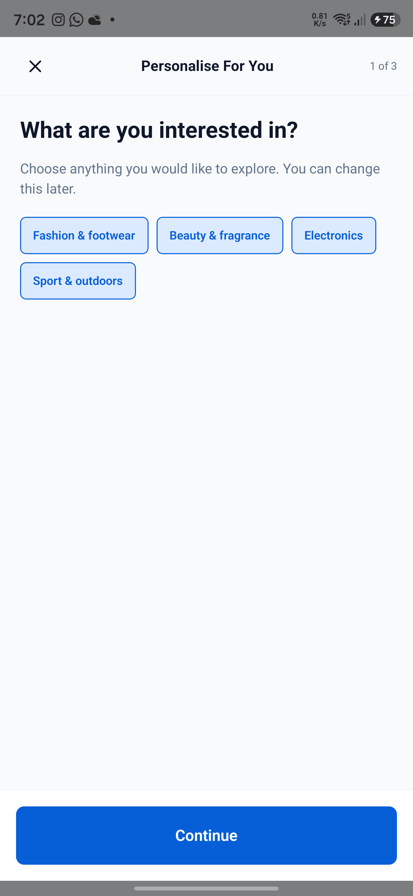
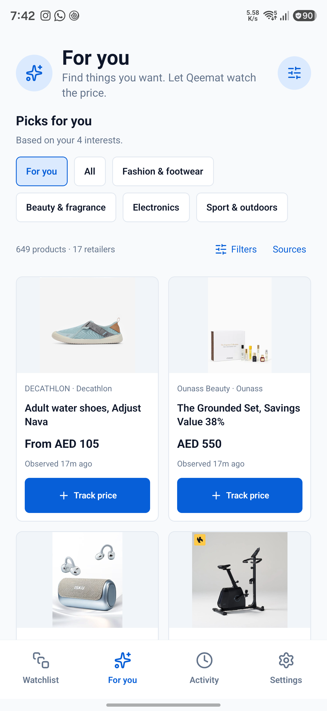
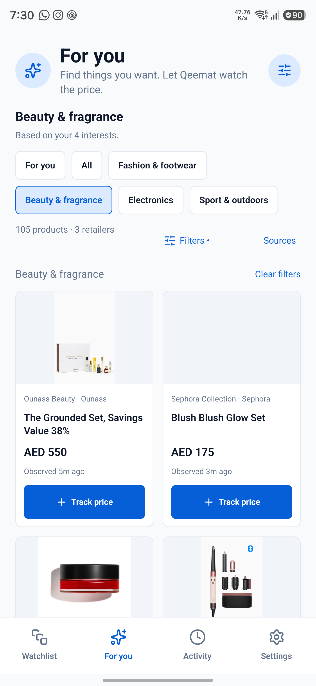
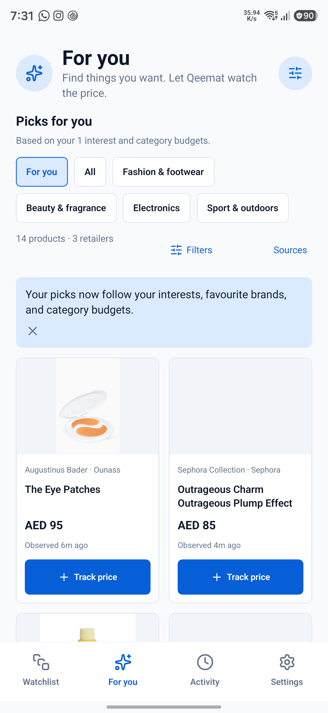
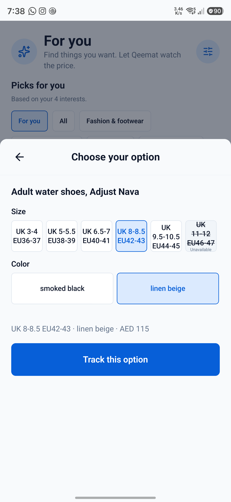
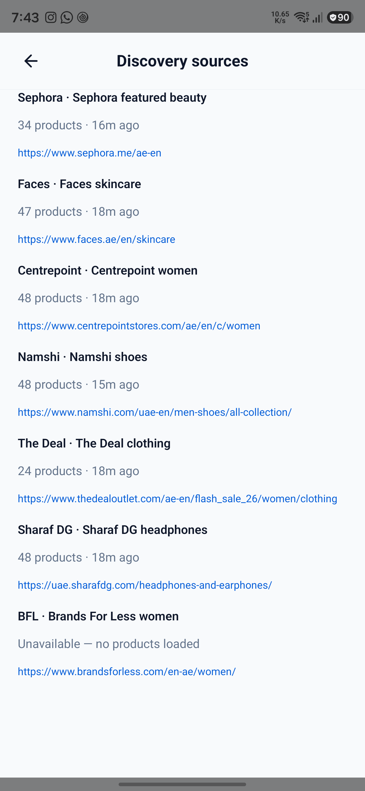
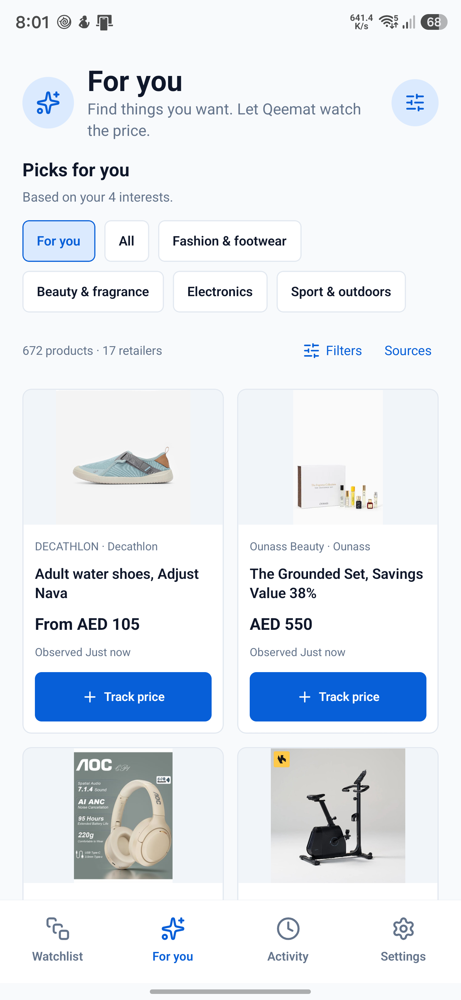

# For You UX and product review

Audit and implementation check: 25 October 2026, connected Galaxy S24 Ultra. The scope is discovery entry, personalization, filtering, source transparency, and adding a tracker. Screenshots below were captured during this audit; the initial screen was not inferred from source code alone.

## What was incomplete

The old experience did not deliver the agreed multi-category discovery promise. Expanding the quiz to four interests before adding matching catalogue supply made that gap more visible.

| Severity | Finding | Consequence | Resolution |
|---|---|---|---|
| Critical | Only three Decathlon collection feeds existed; the outdoors endpoint returned no products | Beauty/electronics choices could not bring matching inventory into the feed | Explicit sources for all 18 tracked retailers; products observed from 17 on Android, with BFL's failure shown |
| Critical | Interests and budgets mostly changed sorting of the same limited products | Quiz completion appeared ineffective | Personalized picks now obey selected interests and per-category budget ceilings; favourite brands rank within those eligible results |
| High | The first source dominated equal-score results | Selecting every interest still looked like a single-store catalogue | Mix categories first and retailers within each category at equal relevance |
| High | Category and brand actions opened a separate listing route | Browsing lost continuity and duplicated screen logic | Category, retailer, brand and price filters update the existing For You grid; obsolete listing route removed |
| High | Picks stopped at six products; repeated sections recycled the same small catalogue | The product supply appeared exhausted quickly | One browseable grid, 24 products initially, with Show more in batches of 24 |
| High | Every fetched product was marked as seen on load | “Newly discovered” did not reflect what the person had actually viewed | Removed that misleading section and whole-catalogue seen write; tracking records only the interacted product |
| High | Concurrent collection updates rewrote one cache object | A successful store's saved results could be lost in another write | Independent collection cache keys, parser-version invalidation and a concurrent-write regression test |
| Medium | Large cards included several tiny secondary actions | Few complete products fit onscreen and touch targets were cramped | Shorter image area, 44dp tracking button, secondary actions in product details |
| Medium | Variant selection navigated to the general Add flow | Leaving discovery reset browsing context | Variant sheet over the feed; source identifiers stay internal when size/colour uniquely identify the option |
| Medium | Source pages/counts/failures were not reviewable in the app | Users could not tell what was being fetched | Sources control with exact fetch URLs, counts, freshness and failure state |

## Captured journey

1. **Original opening feed — incomplete.** Only Fashion/Sport chips and Decathlon products were visible; product cards consumed most of the viewport.

   

2. **Original interest setup — misleading.** All four interests were selected on the phone, while the feed had supply for only two. The expanded choices alone did not complete personalization.

   

3. **Updated feed and same-page filters — working.** All four category choices are visible without horizontal discovery. At this validation point, the feed showed 649 available products from 17 retailers. Category selection stayed on For You; Beauty showed 105 products across three stores.

   

   

4. **Quiz → budgeted feed — working.** Selecting only Beauty with an AED 100 budget produced 14 matching products across Ounass, Sephora and Faces. The screenshot records the tested result; the test preferences were subsequently restored to all four interests, no brand preference and no budget.

   

5. **Exact-option tracking — working.** The sheet preserved the underlying browse screen. Choosing linen beige, UK 8–8.5 / EU 42–43 saved retailer variant `48758281666750` at AED 115, while the listing's `From AED 105` remained an honest range. The source model code remained in saved attributes for checking. The temporary QA tracker was deleted afterward; all 23 original tracker IDs were verified intact.

   

6. **Source availability — visible.** Source rows expose the actual URLs and product counts. BFL did not pass its browser challenge and is explicitly unavailable; the other retailers remain browseable.

   

## Verification and remaining limits

- Automated checks: 19 Jest suites, 190 passing tests, one existing skipped test; strict typecheck passed; lint had no errors and one existing unrelated inline-style warning.
- Final code commits: `0c43d7c` (retailer supply/cache/ranking) and `dc2896c` (quiz and browsing). The arm64 standalone release build passed on 26 October, and APK signature verification passed. APK SHA-256: `f5f75dd937580776c4a252f6058baed58329813e03c9a24a9761a4b9b6f08056`.
- Physical Android checks covered real multi-retailer listing supply, same-page category selection, completing the quiz with a budget, exact variant persistence, and preserving the existing watchlist. On 26 October the final signed release APK installed successfully on SM-S928B and launched without Metro or an ADB port reverse. Installed metadata was `0.5.5-alpha`, versionCode `3`, with no `DEBUGGABLE` flag. The foreground app showed 672 products across 17 retailers after refreshing; the watchlist retained 23 items. No AndroidRuntime or ReactNativeJS errors were reported for the launched app process. Earlier journey screenshots above used the debug build; the release screenshot is below.

  
- A separate live Android product-page batch confirmed parsing for Decathlon, Nike, Sun & Sand, Ounass, Level Shoes, Al Yousuf, Puma and Amazon before the connection was lost. That batch did not finish; this is not a claim that a live product page from every retailer was revalidated. Existing per-store parser tests continue to pass, and each Track price action verifies its selected product page before saving.
- Failure/cache behavior is regression tested. The phone's connectivity was not disabled to claim a physical airplane-mode test.
- The category chips expose selection state; icon controls have names; tracking uses a 44dp target; save feedback uses a live region. TalkBack announcements, focus restoration across every modal, contrast measurements and large-font reflow still need a dedicated accessibility pass. Screenshots do not establish accessibility compliance.
- BFL is the remaining supply failure. The first 24–48 usable records from selected collections are not a whole-retailer catalogue. [Every source URL and its actual limitations](discovery-sources.md) is listed separately.
- There is no trustworthy “new to you” section yet: that needs real viewport impression tracking. Newly released, best-selling and historical-low claims are not invented.
- The existing first-launch notification/battery prompts remain optional but still precede the first discovery session; deferring them until tracking would be a further onboarding improvement.
- Retention has not been established by this build. The five-person, two-minute discovery test and voluntary one-week follow-up remain the product validation gate. No cohort analytics or discovery digest was added.
