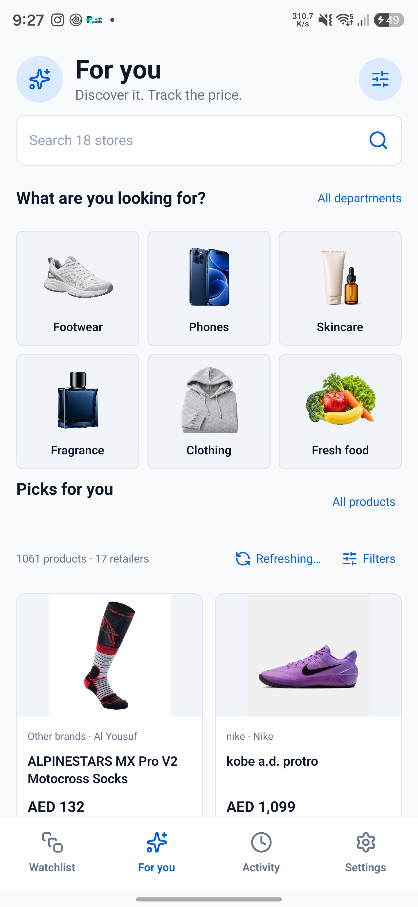
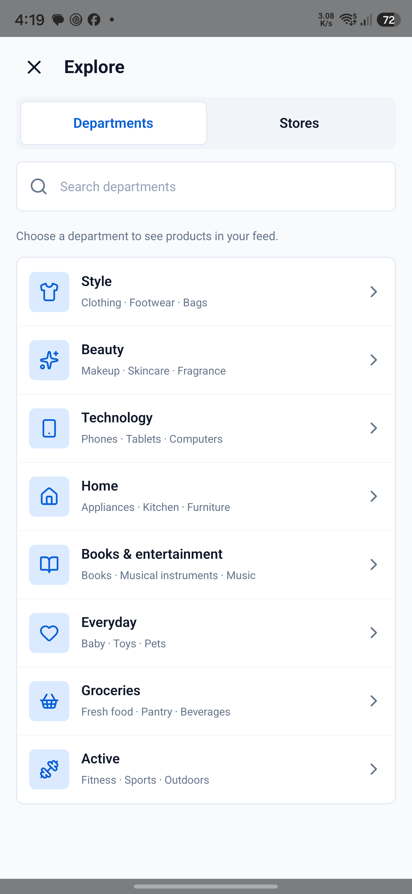
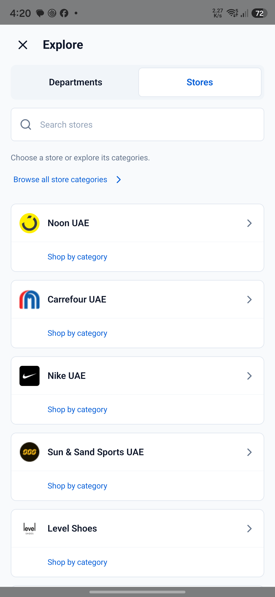
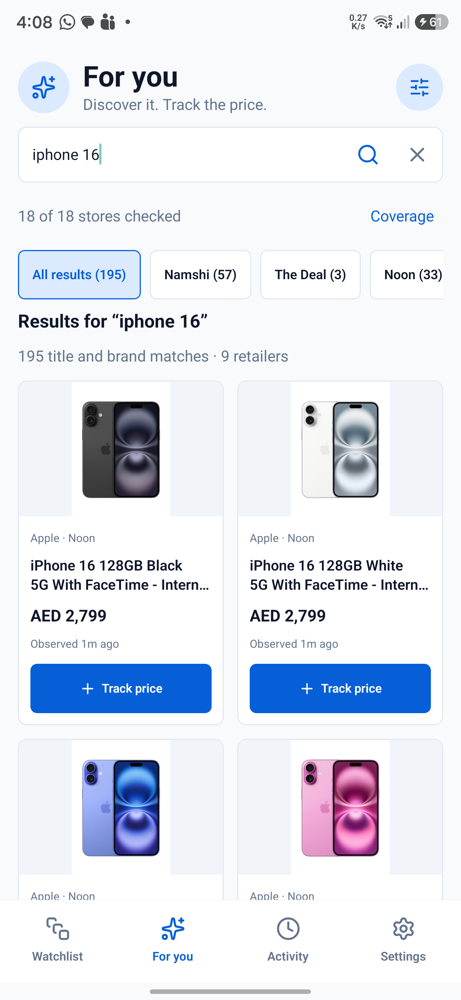
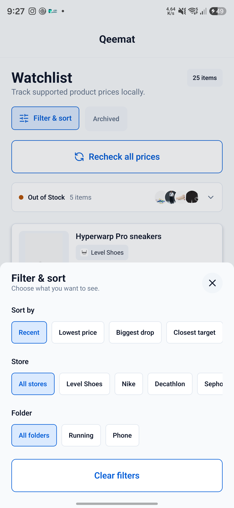
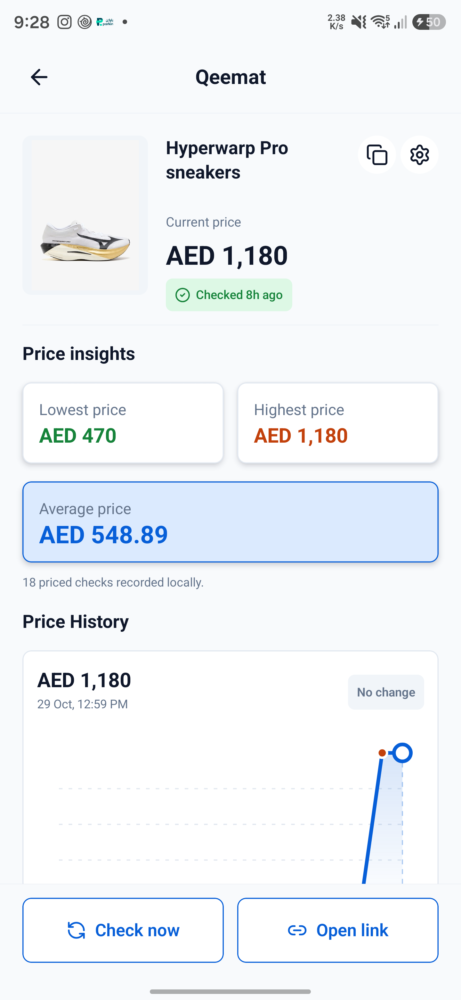
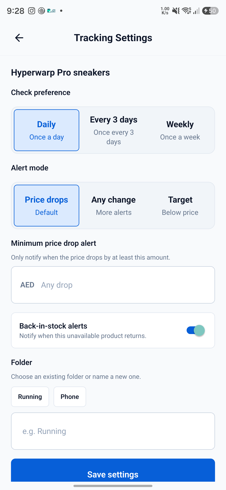
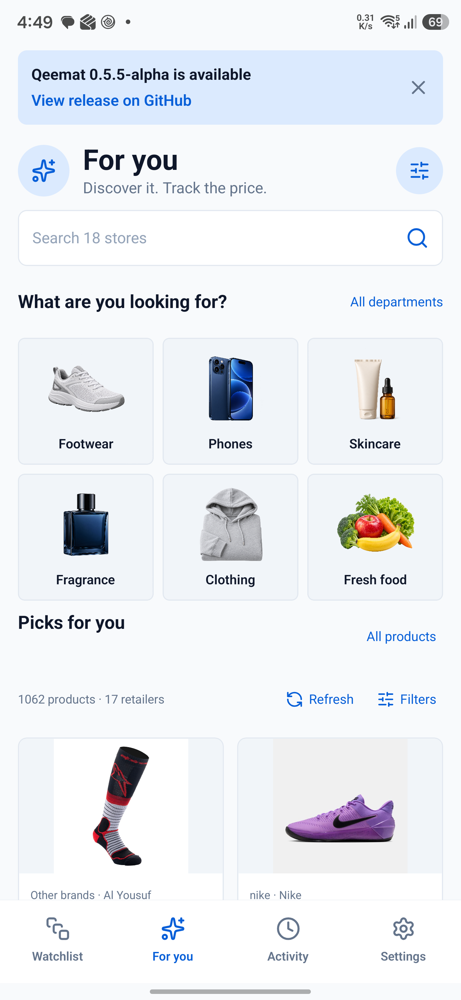

# Qeemat v0.6.0-alpha — What's new since v0.5.5-alpha

**Release notes draft** · 29 October 2026

**Scope:** changes merged into `dev` through commit `ead2680` since the [v0.5.5-alpha release](https://github.com/AdamJeddy/Qeemat/releases/tag/v0.5.5-alpha). The planned release is v0.6.0-alpha; it has not yet been published on GitHub. [Compare changes](https://github.com/AdamJeddy/Qeemat/compare/v0.5.5-alpha...dev).

Qeemat has grown from a link-first price tracker into a place to find products, compare options across shops, and keep a more useful watchlist. Your products, preferences and history remain on your device.

## Highlights

- **A new For You experience:** browse product recommendations and departments before you have a product link.
- **Search across retailers:** type a product name and see available matches in the same feed.
- **A more manageable watchlist:** organize products into folders, sort and filter them, and act on several at once.
- **More useful tracking:** see local price insights, explore the price chart and choose more specific alerts.
- **More shops:** Carrefour UAE, Salomon GCC and The Deal UAE join supported tracking.
- **Update notices:** Qeemat can tell you when a newer version is available on GitHub.

## Discover something worth tracking

For You is now the opening screen. Browse visual departments such as footwear, phones, skincare, fragrance, clothing and fresh food, or open **All departments** for more. Choose interests, favourite brands and individual budgets in the optional preferences; skip them if you prefer to browse broadly. Choices can be edited later.

Explore departments or stores without leaving the feed. The catalogue maps 4,517 listing pages across 19 retailer sources and 56 independent shopping interests, including groceries, household, pets and specialist departments. These are mapped sources, not a guarantee that every page will load or that every store's entire inventory is available. You can inspect source details and see which collections are unavailable.

## Search across stores

Search for a product name directly from For You. Results arrive as stores respond, and the retailer filter shows stores with matching products. Open a product or choose **Track price** to verify its current product page and, where required, select its size, colour or configuration before saving. Clearing search returns you to your previous browsing position.

Search is implemented for 18 sources; Sharaf DG search is not included yet. Results depend on each retailer, query and connection, and some sources may be blocked or return only part of their catalogue. Previously cached matches can remain visible when a store cannot be reached.

## Keep a larger watchlist organized

- Place tracked products in local **folders** and filter by folder or retailer.
- Sort by recent update, lowest price, biggest drop, closest target or name.
- Long-press to select products and move, pause, resume, archive, restore or delete them in bulk.
- Archive products you want to keep without active tracking and return to them later.

## Understand prices and choose alerts

Product details now show locally recorded lowest, highest and average prices, with context for the current price. Tap the interactive price-history chart to inspect individual recorded checks. These insights describe **your device's recorded history**; they are not a retailer's all-time price history.

Choose a minimum price-drop threshold and decide whether to receive a back-in-stock alert for each product. Product checks continue to preserve the last known price when an item is out of stock.

## More stores and safer tracking

- **Carrefour UAE:** track supported Carrefour product offers; a specific seller and offer remain tied to the tracker. For supported weighted groceries, prices and targets show a per-kilogram basis. Final checkout prices may depend on delivery context and weight.
- **Salomon GCC:** track supported products and their available source-defined options.
- **The Deal UAE:** track supported products; colour and size combinations are verified before saving when the retailer supplies the necessary data.
- Reliability improvements cover Namshi redirects, Adidas checks, exact variants, out-of-stock changes and background checks. Brands For Less remains experimental and is not a fully supported tracking source.

## Know when Qeemat has an update

When a newer downloadable GitHub release is available, a dismissible notice appears on For You, Watchlist and Settings. Qeemat also checks approximately every two days in the background and can notify you once per new version. Tap the notice to open the GitHub release page and install the update yourself. Notifications require Android permission; battery and system restrictions can delay background work.

*The update screenshot is a test using an older app version; it does not mean a newer release is available now.*

## Refreshing, privacy and current limits

- Discovery listings are reused for around 24 hours; **Refresh** or pull-to-refresh requests fresh results for the current view. A newly opened, uncached department can load immediately.
- Products and observed prices vary by retailer, location and time. Cached results remain available when a retailer fails, with their age shown where available.
- Only products you track enter background price checks. Preferences, watchlist, history and discovery cache stay on your device; there is no account or recommendation backend.
- Retailers can change their sites or block requests. Product listing and search coverage varies; not every mapped listing or category has been validated end to end on Android.

## About these images

The For You, watchlist-filter, price-insight and alert screenshots were captured on a connected Samsung Android phone on 29 October 2026. The alert screenshot shows an unsaved selection for illustration. Search, department and store screenshots were captured on 28 October. The update notice is a 28 October test capture. Product availability, prices and counts are examples from those moments and may have changed. Earlier screenshots may show small layout differences from the current app.
