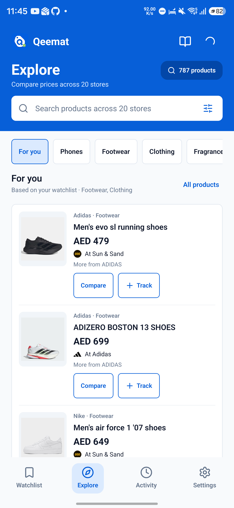
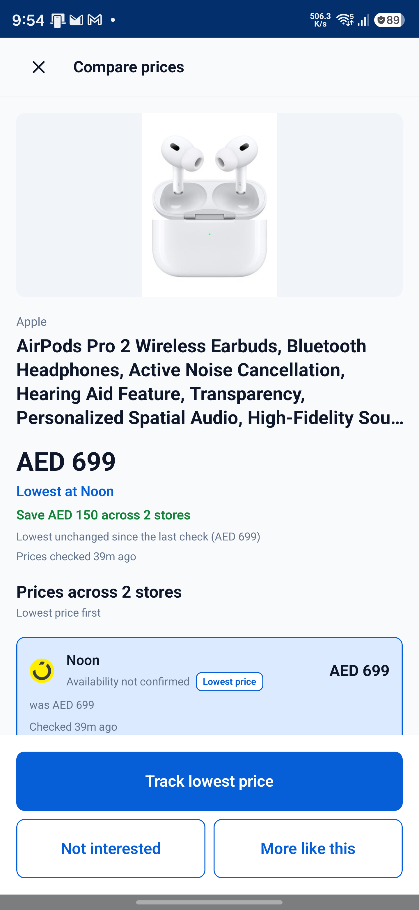
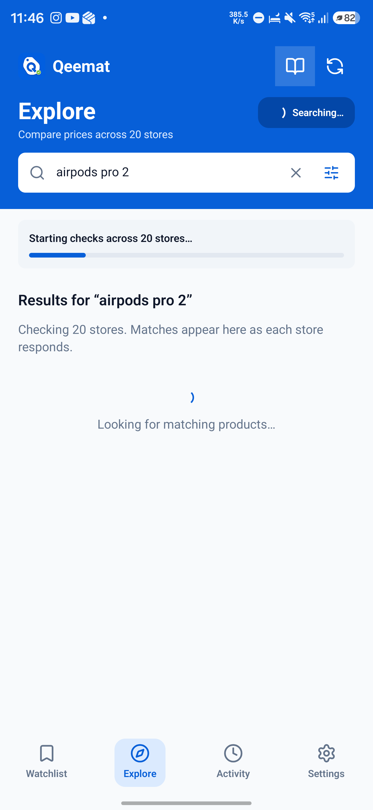
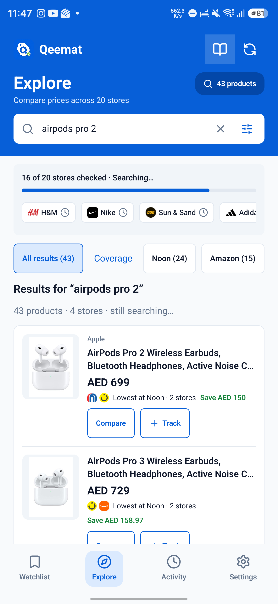
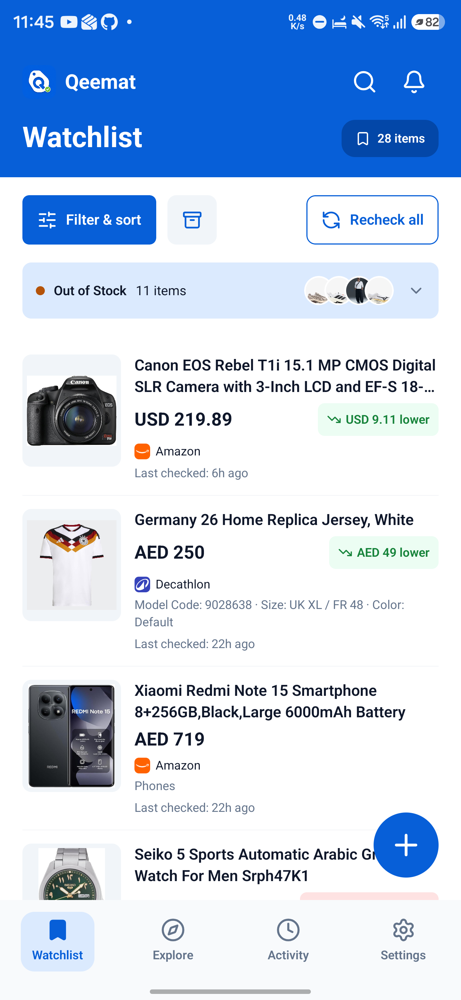
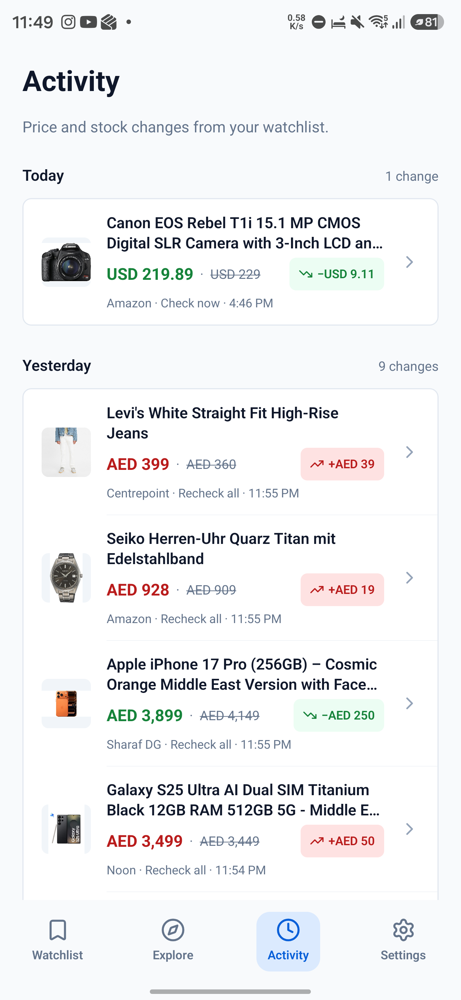
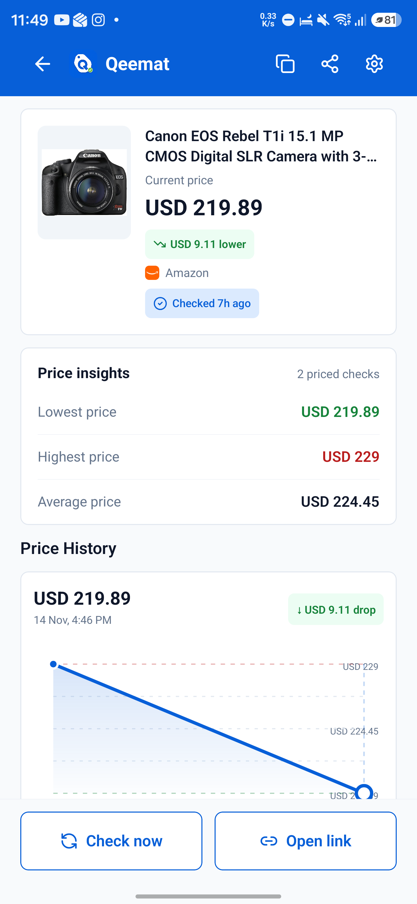

# Qeemat v0.6.5-alpha — Explore, sharper search and a faster app

**Release notes draft** · 14 November 2026

**Scope:** changes merged into `dev` through commit `92b2894` since the [v0.6.0-alpha release](https://github.com/AdamJeddy/Qeemat/releases/tag/v0.6.0-alpha). The planned release is v0.6.5-alpha. [Compare changes](https://github.com/AdamJeddy/Qeemat/compare/v0.6.0-alpha...dev).

Qeemat now has a proper place to discover products: **Explore**, a watchlist-aware, cross-store comparison feed. Search is faster and more transparent, product details and Activity are easier to scan, and Qeemat can download and install its own updates. Everything still stays on your device.

## Highlights

- **Explore:** the old Search tab is now a comparison-first feed, shaped by the products you already track.
- **One product, many stores:** compatible retailer listings are clubbed into one row with the lowest source and a compare sheet, instead of duplicate search results.
- **Search that shows its work:** results stream in while an animated card shows which stores have answered; multi-store matches rise within their relevance band.
- **A faster app:** compact product details, clearer price-chart labels, calendar-day Activity groups and a more consistent Watchlist.
- **Updates inside Qeemat:** newer releases can be downloaded and installed from the app, with a new “New Qeemat just dropped 🎉” background notification.
- **More UAE retailers:** H&M UAE and Zara UAE join supported tracking.

## Explore, built around your watchlist

Explore is the new opening point for finding something to track. Its feed is ordered by a local taste profile built from your active tracked products — categories, brands, distinctive title words and price bands — and each row explains itself with a reason such as “More from ADIDAS” or “Because you track running shoes”. With no watchlist signal, it falls back to a rotating catalogue selection.

Products already on your watchlist are hidden from Explore unless another retailer offers a genuinely cheaper comparable price. When that happens, the row says **On your watchlist** and shows the saving against your tracked price.

## One product, many stores

The same product listed by several UAE retailers becomes one grouped row. Brand, product type, model numbers and capacity/pack tokens must agree; then Qeemat shows the lowest comparable source instead of making you compare three near-identical results.

Open **Compare** to see each retailer’s own title, price, availability, previous observation and check age, ordered lowest price first. A “Lowest at X” claim only appears when at least two in-stock, single-price offers share the same currency and pack/weight basis. Out-of-stock and “from AED” range offers stay visible but cannot win.

Grouping is deliberately conservative and happens locally from retailer titles. It can still miss a match when retailer wording differs, or occasionally group two closely named products; the retailer titles remain visible in Compare so you can verify an offer.

## Search that shows its work

Search from the Explore banner across 20 storefronts and 27 weighted source requests. Results arrive as stores respond, an animated progress card shows which stores are checking, ready, empty or unavailable, and cached matches stay visible while stores revalidate. Clearing search returns you to the feed and its position.

Results are ranked so named products come before compatible accessories. Items available at more retailers rise within the same textual match grade, while an exact product match never loses to a weaker one just because the weaker one has more sources. Reaching the bottom loads the next page automatically — no Show more or Load more buttons.

Search coverage depends on the retailer, query and connection. Sharaf DG search is not included yet, some sources may be blocked or return only part of their catalogue, and cached results remain visible when a store cannot be reached.

## Watchlist and Activity, easier to scan

The Watchlist keeps its store and folder controls, pull-to-refresh and **Recheck all**, with a cleaner card rhythm and clearer status for each tracked product.

Activity is now grouped into stable local calendar days — **Today**, **Yesterday**, then dated sections — with one change count per day. The new price comes first, the previous price is struck through, and an explicit delta badge shows the movement: red for a rise, green for a drop. Each row shows retailer, source and check time underneath.

## Product details at a glance

Product detail now opens with a compact summary: image, two-line title, current or last-known price with direction, retailer, variant/folder and check status. Price insights and the item information sit in flat cards, while the price chart plots only the points where the price actually changed and labels the high, middle and low values directly on the chart. Drag across the chart to inspect an earlier check; **Check now**, **Open link**, copy and share remain one tap away.

## New stores and tracking reliability

- **H&M UAE:** track supported products with the selected size SKU; colour choices use separate product URLs.
- **Zara UAE:** track supported products with the chosen size retained for later checks.
- Amazon Renewed and short `dp` links are normalized so they remain checkable instead of landing on a modal shell.
- Exact variant selection, out-of-stock handling and background checks keep their existing safety rules: the last known price is preserved for out-of-stock items, and a missing or out-of-stock variant never silently becomes another product.

## Updates inside the app

When a newer GitHub release is available, Qeemat now offers **Download and install** directly. It picks an APK for the device architecture, downloads it over HTTPS, checks the file size and SHA-256 when GitHub publishes a digest, and opens Android’s install prompt. If install permission is missing, the popup explains how to allow it and keeps the verified download ready for **Install update**.

A background check runs approximately every 48 hours and posts one notification per release on the **App updates** channel: **“New Qeemat just dropped 🎉”** / **“A new version is ready. Open the app to install it.”** Tapping it opens Qeemat. Notifications require Android permission, and battery or system restrictions can delay background work.

The download runs while Qeemat is alive; if Android kills the app mid-download, the next attempt starts again. Android still verifies the signing certificate before applying the update.

## Privacy, limits and alpha notes

- Qeemat remains Android-first, local-first and backend-free. Tracked products, folders, price history and discovery cache stay on the device; there is no account or recommendation server.
- Prices and availability are observations from retailer pages, not live guarantees. Grouping and “lowest” claims are local inferences; retailers can change layouts, block requests or return partial results.
- Background checks are best effort and may be delayed by Android or device-vendor battery restrictions.
- iOS native support is not maintained in this release.
- H&M, Zara, Amazon, Adidas and other store parsers are sensitive to storefront changes; not every mapped category or search source is verified end to end.

## Validation

- `npm run typecheck` — passed.
- `npm run lint` — 0 errors; one pre-existing inline-style warning in `App.tsx`.
- `npm test -- --runInBand` — 61 suites, 579 passed, 1 skipped.
- Android arm64 release build passed; APK is versionName `0.6.5-alpha`, versionCode 5, signed consistently with the previous release so it can update an existing install.
- Screenshots captured on a connected Samsung SM-S928B (1440 × 3120) on 14 November 2026 from the release candidate. Prices, counts and availability are examples from those moments and may have changed.

The APK for this release is attached separately; the screenshots in this folder are the ones referenced above.
